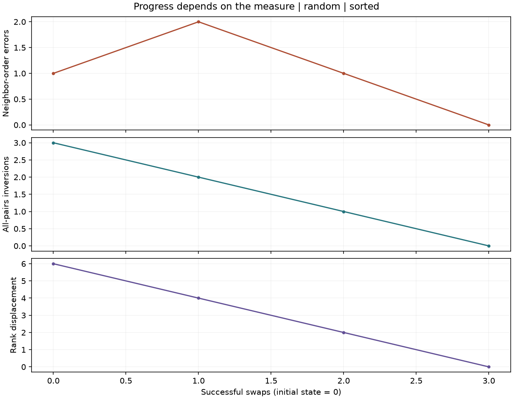
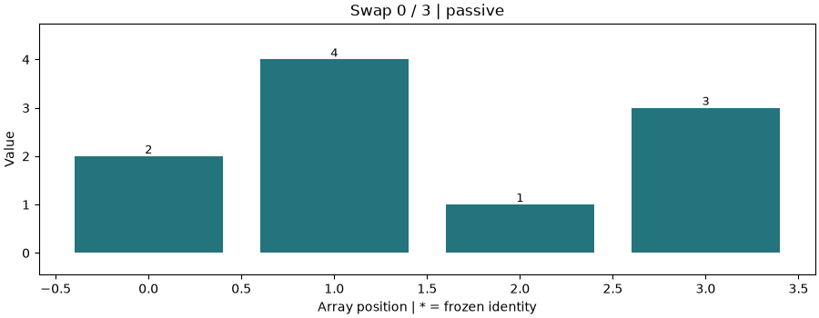
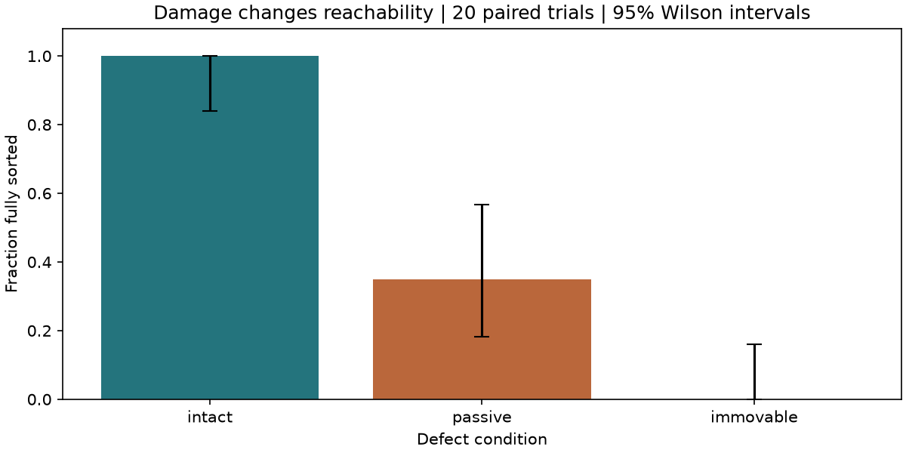
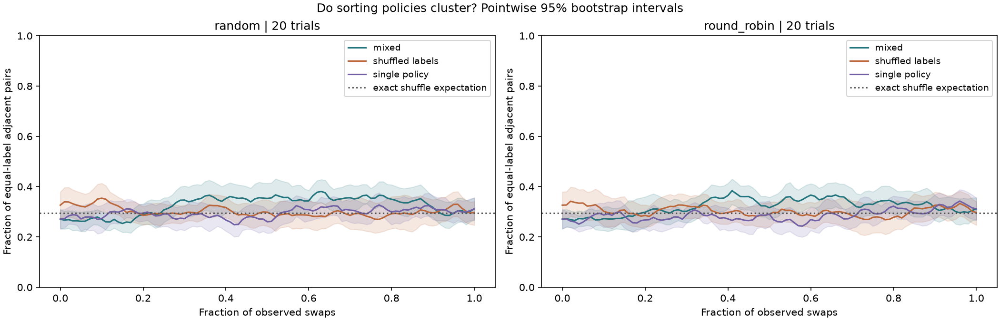

# Validation record

Validated locally on macOS arm64, Python 3.12.13, using the committed uv lock.
The GitHub workflow also checks Python 3.10 and 3.12 on Linux.

## Automated checks

- 46 tests passed. The permutation tests include all 24 orderings of four
  distinct values, three policies, two deterministic schedulers, and both sorting
  directions (288 sorting runs inside those parametrized tests).
- Frozen-cell stopping, distinct sampling, isolated mutable defaults, and the
  repaired compatibility command are covered by regression tests.
- All six tested scheduler/defect-mode combinations replay their event logs,
  including mixtures under actual OS threads. Worker threads are joined.
- Tampered event logs are rejected; existing recordings are not overwritten.
- Small end-to-end damage and clustering studies export and replay their runs.
- Ruff and `git diff --check` pass for the supported code and patch.
- All three notebooks execute in fresh Jupyter kernels and include inline plots.
- Wheel and source distributions build; the wheel's dependency-free simulation
  and replay commands are checked from a separate virtual environment.

## Example run

```sh
MPLBACKEND=Agg cell-sorting examples --trials 20 --output outputs/validation-examples
python scripts/execute_notebooks.py --output outputs/executed-notebooks
```

The committed notebooks were executed with their displayed parameters. Figures
and summary CSV files from the command-line run are in [assets](assets/).
Full raw recordings are generated by the command rather than committed.

### Progress

Values `[2, 4, 1, 3]`, bubble policy, random scheduler, seed 2. The first swap
produces `[2, 1, 4, 3]`: adjacent errors increase from 1 to 2 while inversions
decrease from 3 to 2. The trace then reaches sorted order.





### Damage

20 paired trials, 12 distinct values, two distinct frozen identities in each
damaged trial, random scheduler, study seed 17:

| Condition | Sorted | Stuck | Limited | Success rate, marginal 95% Wilson interval |
| --- | ---: | ---: | ---: | --- |
| Intact | 20 | 0 | 0 | 1.00 [0.839, 1.000] |
| Passive frozen | 7 | 13 | 0 | 0.35 [0.181, 0.567] |
| Immovable frozen | 0 | 20 | 0 | 0.00 [0.000, 0.161] |

These are outcomes under the permitted bubble swaps, not an assertion that
another algorithm could never rearrange the same array.



### Clustering

20 trials per scheduler, 18 distinct values, balanced three-policy labels, study
seed 29. All 80 mixed and single-policy runs sorted. Mean differences below are
averages over 101 normalized-swap points, with paired 95% bootstrap intervals:

| Scheduler | Contrast | Mean difference | 95% interval |
| --- | --- | ---: | --- |
| Random | Mixed minus shuffled labels | 0.0241 | [-0.0284, 0.0757] |
| Random | Mixed minus single policy | 0.0310 | [0.0023, 0.0600] |
| Round robin | Mixed minus shuffled labels | 0.0191 | [-0.0297, 0.0647] |
| Round robin | Mixed minus single policy | 0.0358 | [0.0121, 0.0600] |

The small positive differences against single-policy controls do not establish
a general effect across parameters. Both shuffled-label contrast intervals
include zero. This limited experiment supports further controlled exploration,
not a claim that the original paper's effect size has been replicated.


